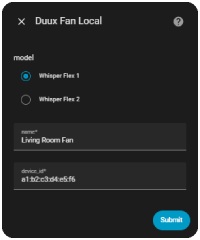
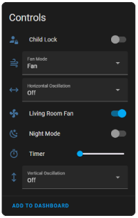
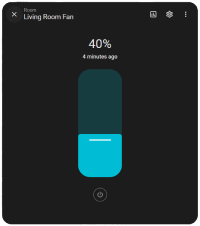
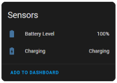

[![GitHub Release][releases-shield]][releases]
[![License][license-shield]][license]
[![hacs][hacs-badge]][hacs]
[![pre-commit][pre-commit-shield]][pre-commit]
[![Black][black-shield]][black]

# 🌀 Duux Local - Home Assistant Integration

**Take back control of your Duux smart devices - locally, privately, and cloud-free.**

This project allows you to use your **Duux smart devices** (fans, air purifiers, heaters, humidifiers, etc.) entirely outside of Duux’s cloud ecosystem by redirecting their MQTT communication to a **local broker**, giving you **full local control** via **Home Assistant**.

No cloud. No account. No lag.

## Supported devices

This integration uses a flexible Device Profile architecture designed to easily embrace the entire Duux product family.

| Model | Category | Detailed Specifications |
|---|---|---|
| **Duux Whisper Flex** | Fan | [📖 View Features & MQTT Specs](docs/devices/whisper-flex.md) |
| **Duux Whisper Flex 2** | Fan | [📖 View Features & MQTT Specs](docs/devices/whisper-flex-2.md) |
| **Duux Whisper Flex Ultimate** | Fan | [📖 View Features & MQTT Specs](docs/devices/whisper-flex-ultimate.md) |
| **Duux Bright 2** | Air Purifier | [📖 View Features & MQTT Specs](docs/devices/bright-2.md) |
| **Duux Bora Smart** | Dehumidifier | [📖 View Features & MQTT Specs](docs/devices/bora-smart.md) |


### Help expand support

If you own any other devices that connect to the Duux Cloud (Dehumidifiers, Heaters, other Fans/Humidifiers/Purifiers, Air Conditioners), you can help add support!
Simply capture your device's MQTT payloads and open an Issue or a Pull Request with your device's specifications.

## Installation via HACS

This integration is not (yet) available in the official HACS default repository list.
However, you can easily add it as a **custom repository**:

[![Open your Home Assistant instance and open a repository inside the Home Assistant Community Store.][myha-repo-badge]][myha-repo]

1. Open **HACS** in your Home Assistant interface
2. Click the **three dots (⋮)** in the top-right corner and select **"Custom repositories"**
3. Paste the following URL:
   `https://github.com/LouisR-git/duux-fan-local`
4. Select **"Integration"** as the category
5. Click **Add**, then search for `Duux Fan Local` in HACS and install it
6. Restart Home Assistant to finalize the setup

The integration will now appear like any standard Home Assistant integration.

### Initial setup

1. Follow the **instructions below** to install the required prerequisites:
   - ✅ **DNS redirection** (reroute Duux API calls to your local Broker)
   - ✅ **MQTT Broker** (Mosquitto, EMQX, ...)

2. In Home Assistant, go to `Settings > Devices & Services > Add Integration` and search for `Duux Fan Local`.
3. Provide your **MQTT broker credentials** (or leave blank for anonymous) and adjust the **MQTT Host and Port** if necessary.
4. Select your **device model** from the list.
5. Give your device a friendly name.
6. Enter the **MAC address** of your Duux device.
   > 💡 You can find it in your router’s connected devices list.
7. Click **Submit** and enjoy local control of your device!

### Screenshots






## Prerequisites

Duux devices communicate with the cloud using **MQTT over TLS**.
By spoofing the cloud hostname and running your own MQTT broker, you can intercept this traffic and integrate the devices directly into Home Assistant.

You’ll need:

- **Control over your local DNS resolution** (AdGuard, CoreDNS, dnsmasq…)
- **A self-hosted MQTT broker**, default reachable as `collector3.cloudgarden.nl` on port 443 (can be customized during integration setup)
- Basic Linux CLI knowledge

## Local DNS spoofing

From your local DNS server, redirect the Duux cloud MQTT hostname(s) to your local MQTT server’s IP:
```
collector3.cloudgarden.nl → 192.168.x.x
collector.cloudgarden.nl  → 192.168.x.x
```

> 💡 **Note:** Some devices or firmware versions query `collector.cloudgarden.nl` instead of `collector3.cloudgarden.nl`. Redirecting both hostnames ensures continuous connectivity.

### Example: AdGuard DNS rewrite

Go to AdGuard → Settings → DNS Rewrites

### Example: Ubiquiti Unifi Gateway

Go to Console → Settings → Policy Engine → DNS → Create a new `Host (A)` entry

### Reboot the device after DNS changes
Unplug → remove the battery (if applicable) → wait ~1 second → reinsert → power on.


## Setting up a local MQTT broker

### Option A - EMQX (TLS + Authentication) - **Recommended**
- **Goal:** A robust local setup with TLS encryption and username/password authentication.
- 📖 See the [EMQX installation guide](docs/guide-emqx.md)

### Option B - Mosquitto (Anonymous TLS)
- **Goal:** The quickest option for labs or testing environments.
- ⚠️ **Security:** Not secure (anonymous access).
- 📖 See the [Mosquitto installation guide](docs/guide-mosquitto.md)

### Option C - Home Assistant Mosquitto Broker Add-on (Manual TLS + Auth)
- **Goal:** Reuse your existing official Home Assistant Mosquitto Broker add-on.
- 📖 See the [HA Mosquitto Broker Add-on guide](docs/guide-ha-mosquitto-addon.md)

### External Community Project — Automated Add-on
- **Goal:** Automate certificate generation, embedded TLS on port 443, and MQTT Discovery.
- ⚠️ **Note:** This is an independent, external community project developed by [@BluPix](https://github.com/BluPix):
  👉 [duux-fan-local-addon](https://github.com/BluPix/duux-fan-local-addon)


## Supported Features by Device

Each device category and model supports dedicated Home Assistant entities and MQTT commands. Click on a device below to view its full feature and command table:

- 🌀 **[Duux Whisper Flex](docs/devices/whisper-flex.md)** — Fan, speed 1–26, natural wind, night mode, timer, oscillation.
- 🌀 **[Duux Whisper Flex 2](docs/devices/whisper-flex-2.md)** — Fan, speed 1–30, battery level, charging sensor, 3D oscillation, child lock.
- 🌀 **[Duux Whisper Flex Ultimate](docs/devices/whisper-flex-ultimate.md)** — Fan, speed 1–30, temperature setpoint, 3D oscillation, preset modes.
- 🍃 **[Duux Bright 2](docs/devices/bright-2.md)** — Air purifier, speed 1–4, air quality index, PM10, TVOC, filter life, ionizer.
- 💧 **[Duux Bora Smart](docs/devices/bora-smart.md)** — Dehumidifier, target humidity control (30–80%), continuous/auto mode, water tank full sensor.

### Known Limitations

- **Charging Status (Whisper Flex 2):** Does not update automatically when the battery is fully charged.
  The device only refreshes this attribute when the Power state changes.
  This is a **firmware limitation**.


## Details

The devices use MQTT topics to report their state and receive commands.

### Default MQTT Broker Endpoint
```
mqtts://collector3.cloudgarden.nl:443
```

### Device publishes to:

| Topic                         | Example Payload                                                                 |
|-------------------------------|---------------------------------------------------------------------------------|
| `sensor/{device_id}/in`       | `{"sub":{"Tune":[{"uid":"xyz","power":1,"mode":0,"speed":10,"timer": 0,"horosc": 0,"verosc": 0,"lock": 0,"night": 1,"batcha": 0,"batlvl": 10}]}}` |
| `sensor/{device_id}/online`   | `{"online":true,"connectionType":"mqtt"}`                                       |
| `sensor/{device_id}/update`   | `{"pid":"xyz","tune":"DUUX Whisper Flex 2"}`                                    |

> The device publishes data immediately when a change occurs, and otherwise every 30 seconds to keep the online status active.


### Device subscribes to:

| Topic                          | Example Payload             |
|--------------------------------|-----------------------------|
| `sensor/{device_id}/command`   | `tune set speed 10`         |
| `sensor/{device_id}/config`    | _(Unused)_                  |
| `sensor/{device_id}/fw`        | _(Unused)_                  |


## Result

Your Duux device is now fully **cloud-free** and controllable through **your local network** and **Home Assistant**.
Enjoy full privacy, instant response times, and true independence from proprietary services.

> **Note:** When connected to your local MQTT, the device will no longer be able to receive firmware updates from the manufacturer.
> Disable local DNS forwarding and restart your device to access the web again.

## Cloud Alternative

If you prefer using Duux's cloud API rather than setting up local DNS redirection and MQTT brokers, check out Simon Smale's cloud integration:
👉 [Duux Home Assistant Cloud Integration](https://github.com/SSmale/Duux-Home-Assistant)

## Credits

Based on reverse engineering, packet sniffing, vibe coding ~~and a lot of fan noise~~.
A special thanks to the Home Assistant community for their valuable insights and contributions, especially the discussion in [this topic][ha-forum-duux-topic] which greatly helped this integration.
Contributions welcome! 🛠️


---

<!-- badge -->
[hacs]: https://hacs.xyz
[hacs-badge]: https://img.shields.io/badge/HACS-Custom-orange.svg?style=for-the-badge
[license]: https://github.com/LouisR-git/duux-fan-local/blob/main/LICENSE
[license-shield]: https://img.shields.io/github/license/LouisR-git/duux-fan-local.svg?style=for-the-badge
[releases]: https://github.com/LouisR-git/duux-fan-local/releases
[releases-shield]: https://img.shields.io/github/release/LouisR-git/duux-fan-local.svg?style=for-the-badge
[pre-commit]: https://github.com/pre-commit/pre-commit
[pre-commit-shield]: https://img.shields.io/badge/pre--commit-enabled-brightgreen?style=for-the-badge
[black]: https://github.com/psf/black
[black-shield]: https://img.shields.io/badge/code%20style-black-000000.svg?style=for-the-badge
[myha-repo]: https://my.home-assistant.io/redirect/hacs_repository/?repository=duux-fan-local&category=Integration&owner=LouisR-git
[myha-repo-badge]: https://my.home-assistant.io/badges/hacs_repository.svg
<!-- ref -->
[ha-forum-duux-topic]: https://community.home-assistant.io/t/experience-integrating-duux-products/386403
